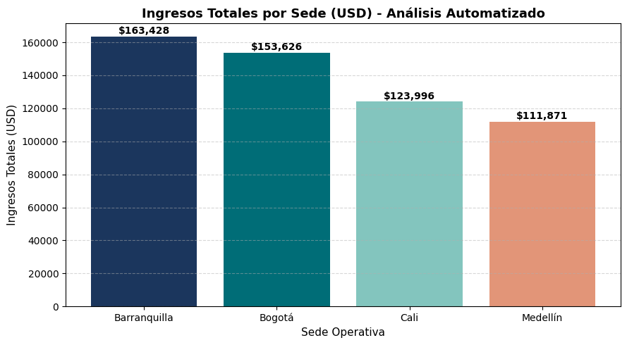

# 📊 Python Data Analysis & Automated Reporting Pipeline

Pipeline de limpieza de datos, análisis exploratorio (EDA) y automatización de reportes estadísticos usando Python y Pandas.

## 🛠️ Tecnologías y Librerías Utilizadas
* **Lenguaje:** Python 3.x
* **Manipulación y Análisis:** Pandas, NumPy
* **Visualización de Datos:** Matplotlib, Seaborn
* **Entorno de Ejecución:** Google Colab / VS Code
* **Control de Versiones:** Git & GitHub

---

## ⚙️ Estructura del Proyecto
```text
├── data/                  # Datasets limpios y crudos (CSV / Excel)
├── notebooks/             # Notebooks de Jupyter / Google Colab con el paso a paso
├── scripts/               # Scripts modulares en Python para automatización
├── outputs/               # Reportes exportados y gráficos generados automáticamente
└── README.md              # Documentación del proyecto

```

---

## 📈 Vista Previa del Reporte Automatizado


---

## 👤 Autor
**Stiven Escobar Carabalí**  
*Data & Business Intelligence Analyst | Jr. Software Developer*  
[GitHub Profile](https://github.com/stiven-escobar)
